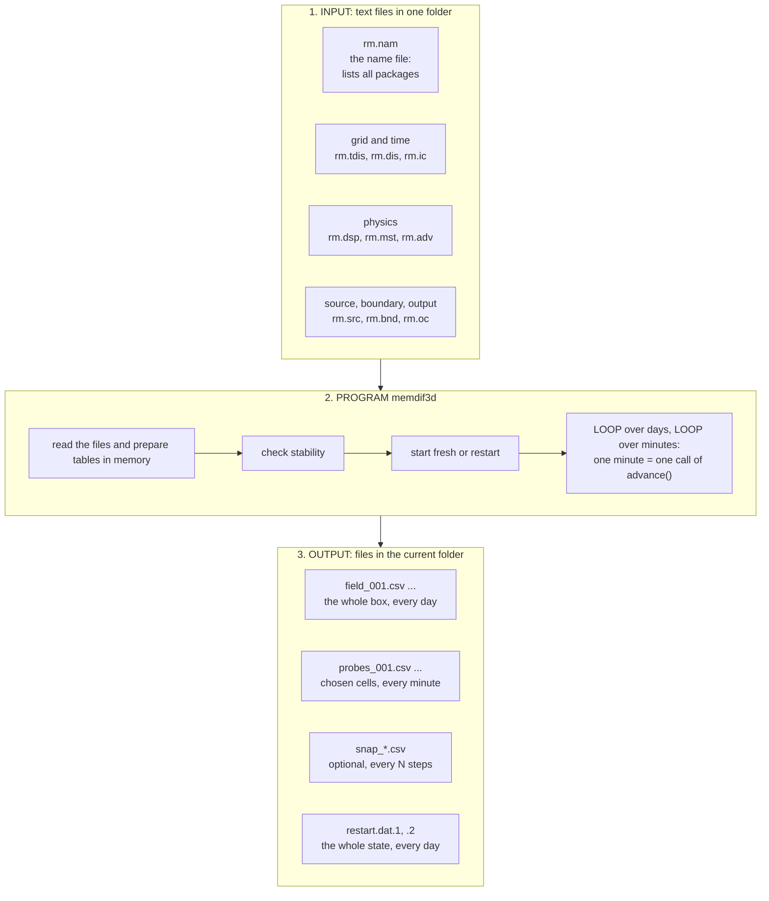
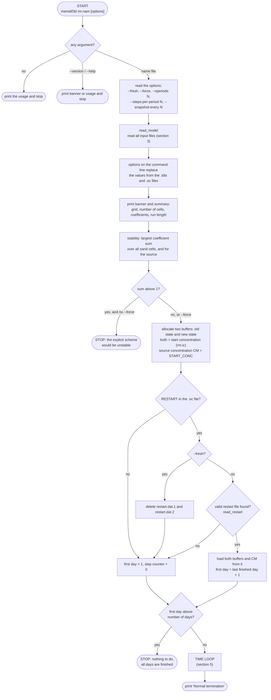
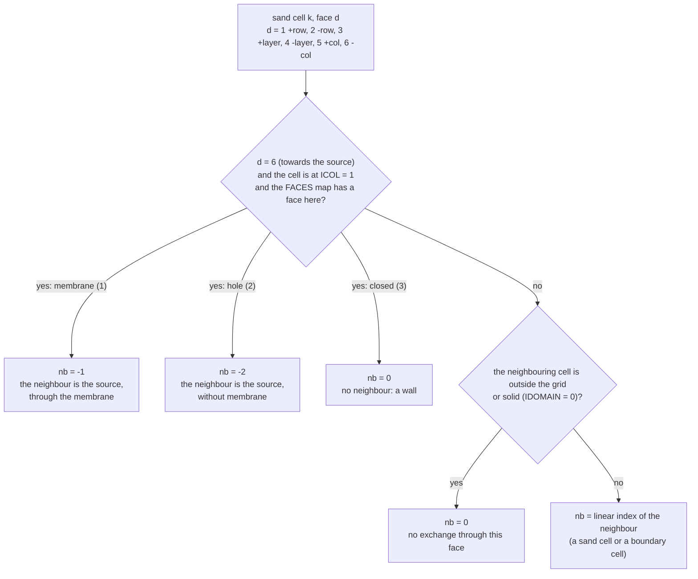
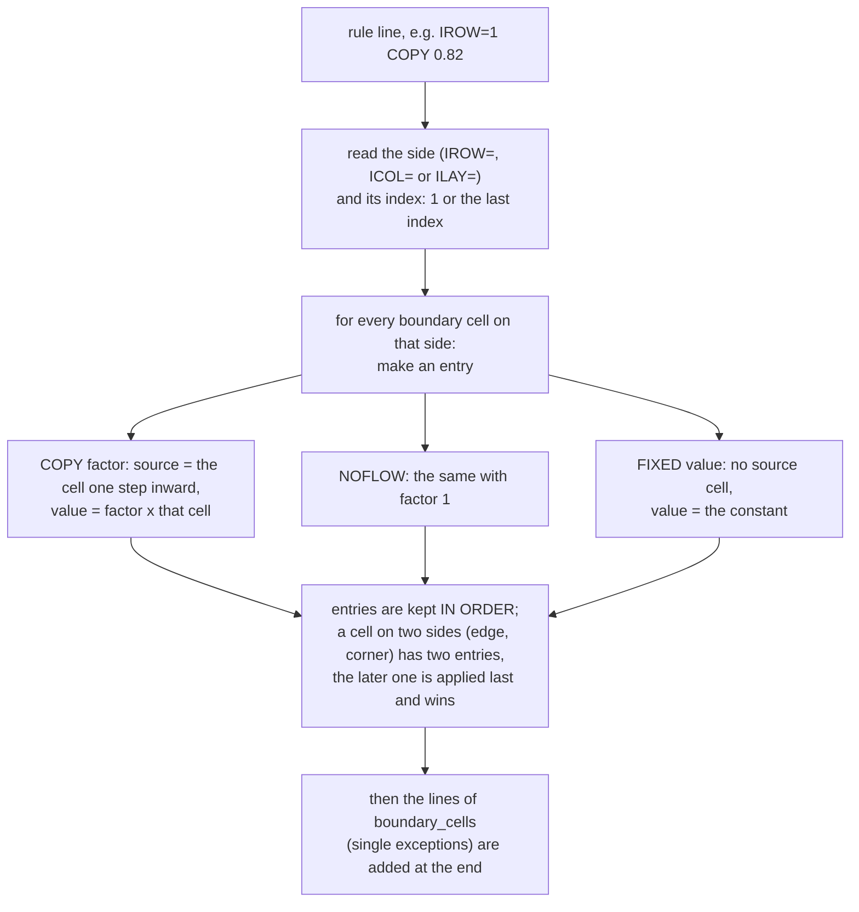
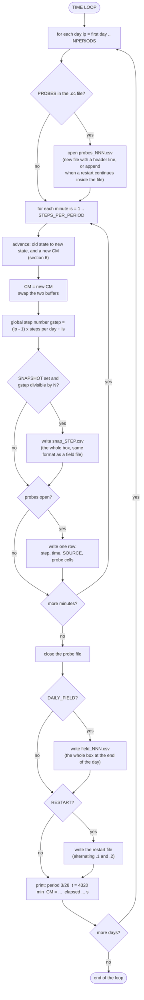
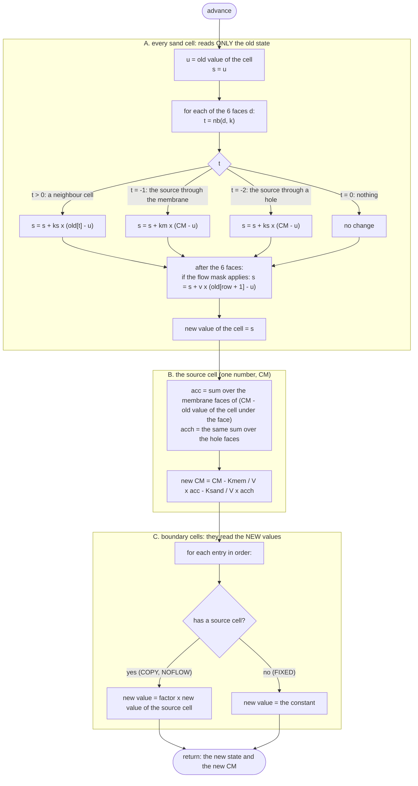
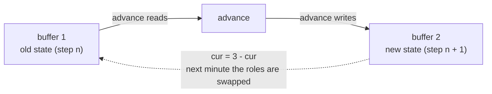
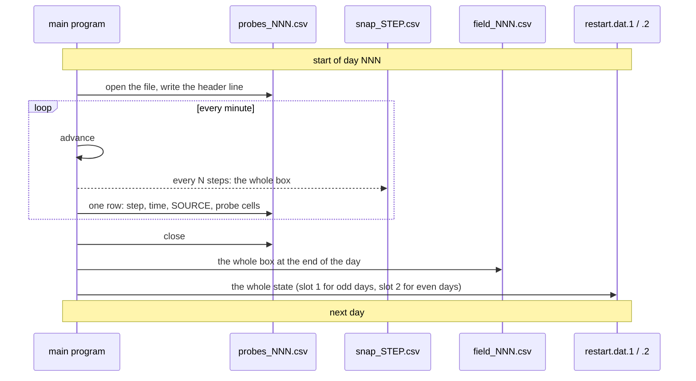
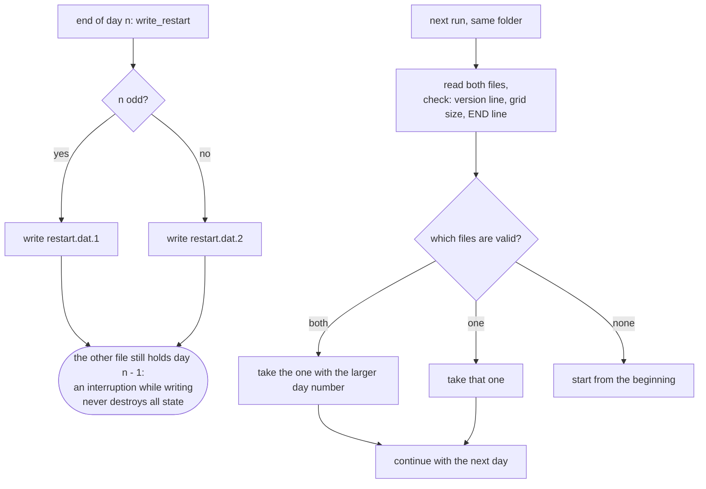

# How the Fortran program works

This page follows one run of `memdif3d` from the command line to the last output file. It is written for teaching: every diagram can be shown on a screen and talked through, and every box names the place in the source code where it happens. The example numbers are from the Reduced_Matrix case (`data/reduced_matrix/rm.nam`).

How to read the diagrams: a rounded box is a start or a stop, a diamond is a question, a rectangle is a step. Text in `code font` is a file, a variable or a routine of the program.

## 1. The big picture



The model is an explicit finite-volume scheme: the box is cut into 1 mm cubes, each cube has one concentration, and in every one-minute step each cube exchanges solute with its six neighbours. The program does three things, in this order: **read and prepare**, **loop**, **write**.

| Part | Where in the source |
|---|---|
| main program: command line, stability check, restart, the two loops | `src/memdif3d.f90` |
| reading all input files and building the tables | `src/input_mod.f90` (`read_model`) |
| one time step, and the stability limit | `src/solver_mod.f90` (`advance`, `stability`) |
| writing field, probe and restart files, reading a restart | `src/output_mod.f90` |

## 2. The main program, step by step



Things worth saying out loud when teaching this diagram:

- **Stability check first.** The scheme is explicit, so a cell must never give away more than it holds. `stability` computes, for every sand cell, the sum of its coefficients (about 6 x `ks`, plus the flow term) and stops the run if it exceeds 1. In the example the largest sum is 0.300.
- **Two buffers.** The program keeps the old and the new concentrations in two arrays and swaps their roles after every step (section 6).
- **Restart.** When a run is interrupted, running the same command again reads the newest restart file and continues with the next day (section 7).

## 3. Reading the input files (`read_model`)

The name file is read first. It lists one file per package. Each package is read in this fixed order, and every one fills part of a variable called `m` (the model, type `model_t`):

```mermaid
flowchart TD
    N["rm.nam<br/>TITLE and the list of package files<br/>(paths are relative to the name file)"] --> T
    T["TDIS: STEP_LENGTH, STEPS_PER_PERIOD, NPERIODS<br/>→ step_len, steps_per_period, nperiods"] --> DI
    DI["DIS: NLAY, NROW, NCOL and the array IDOMAIN<br/>→ grid size, ntot = NLAY x NROW x NCOL<br/>count of boundary cells (IDOMAIN = 2)"] --> I
    I["IC: the array STRT<br/>→ c0 (start concentration of every cell)"] --> DS
    DS["DSP: sand and membrane<br/>K = D x porosity / length / tortuosity<br/>→ Ksand, Kmem"] --> MS
    MS["MST: porosity, bulk density, Kd<br/>R = porosity + density x Kd<br/>→ ks = Ksand / R, km = Kmem / R"] --> S
    S["SRC: VOLUME, START_CONC, the FACES map<br/>→ vol, cm0, list of faces: which ICOL = 1 cell<br/>touches the source, membrane or hole<br/>(closed faces are counted but not listed)"] --> AD
    AD["ADV: VELOCITY and the array ADVMASK<br/>→ vel, mask"] --> FC
    FC["build the table of sand cells and their six neighbours<br/>(section 4)"] --> B
    B["BND: boundary rules, then the exceptions<br/>→ list of boundary cells, each with a source cell and a factor<br/>(section 4), then neighbor_overrides"] --> O
    O["OC: which outputs (DAILY_FIELD, PROBES, RESTART, SNAPSHOT)<br/>and the probe cells<br/>→ file name templates, probe list"]
```



| Package | File | What it gives the program |
|---|---|---|
| TDIS | `rm.tdis` | step length (minutes), steps per day, number of days |
| DIS | `rm.dis` | the grid and `IDOMAIN`: 0 solid plate, 1 sand cell, 2 boundary cell |
| IC | `rm.ic` | the concentration of every cell at the start |
| DSP | `rm.dsp` | diffusion, tortuosity, porosity and length for sand and membrane |
| MST | `rm.mst` | porosity, bulk density and sorption coefficient Kd: the retardation R |
| SRC | `rm.src` | source volume, start concentration, and the FACES map |
| ADV | `rm.adv` | velocity of the flow term and the cells it applies to |
| BND | `rm.bnd` | rules for the outer cells, exceptions, neighbour overrides |
| OC | `rm.oc` | which files to write and which cells to record every minute |

All arrays are written in the MODFLOW order: **column fastest, then row, then layer**. In memory every cell has one number, its linear index, found by

```text
lin(layer, row, col) = col + NCOL x ((row - 1) + NROW x (layer - 1))
```

so that the field file and the `.dis` file list the cells in the same order.

## 4. Preparing the tables

Before the loop starts, `read_model` turns the input into three tables so that a time step is only arithmetic.

### 4.1 The neighbour table `nb(6, k)`

For every sand cell `k` and each of its six faces `d` the program stores one number:



During a step the program only has to look at `nb(d, k)`: a positive number is a neighbour, `-1` is the source through the membrane, `-2` is the source through a hole, and `0` means nothing. The `neighbor_overrides` of the `.bnd` file can change single entries afterwards. The same loop stores the advection neighbour (`advnb`: the cell at row + 1 where the mask is 1).

### 4.2 The boundary entries

The outer cells (`IDOMAIN = 2`) are not part of the medium. After each step they are set from the cell next to them, by the rules of the `.bnd` file:



### 4.3 The face list for the source

`face(i)` is the linear index of the `ICOL = 1` cell under each membrane or hole face, and `fkind(i)` says which (1 membrane, 2 hole). The source update loops over this list.

## 5. The time loop



In the example, 28 days x 1440 minutes = 40,320 steps. Every step updates 23,922 sand cells, so a whole run is about one billion cell updates. That is why it takes about two seconds.

## 6. One time step in detail (`advance`)

`advance(m, old state, old CM, new state, new CM)` does three things in a fixed order. The order matters, because the third step reads values computed in the first.



### 6.1 Why it is correct to read only the old state

Every sand cell is computed from the **old** concentrations of itself and its neighbours. That is what makes the order of the cells irrelevant, so the loop can even run on several processor cores. The new values go to the other buffer; afterwards the two buffers swap roles:



### 6.2 A worked example with real numbers

These numbers are in the first rows of `probes_001.csv` of the example (source `SOURCE`, and the sand cell `15_22_1`: layer 15, row 22, column 1, directly under the membrane).

Coefficients: `ks = 0.015 / 0.3 = 0.05`, `km = 0.0083333 / 0.3 = 0.027778`; the source has `V = 5625` and 225 membrane faces. At the start the source holds `CM = 1` and every sand cell holds 0.

**Step 1** for the cell under the membrane:
`u = 0`, all neighbours are 0, so only the source term remains: `s = 0 + km x (1 - 0) = 0.027778`. The file says `2.777777777777778E-002`. ✓

**Step 1** for the source: `acc = 225 x (1 - 0) = 225`, `new CM = 1 - 0.0083333 / 5625 x 225 = 0.99966667`. The file says `9.996666666666667E-001`. ✓

**Step 2** for the same cell: `u = 0.027778`. Four of its five neighbours are cells under the membrane too, with the same value, so they add 0. The fifth neighbour is the cell behind it (column 2), still 0: `ks x (0 - 0.027778) = -0.001389`. The source term is `km x (0.99966667 - 0.027778) = 0.026997`. The sum is `0.027778 - 0.001389 + 0.026997 = 0.053386`. The file says `5.338580246913581E-002`. ✓

## 7. Outputs and restart



| Output | When | Content | Written by |
|---|---|---|---|
| `field_NNN.csv` | end of each day | concentration of every cell, blocks `# ILAY n`, one line per row, columns across | `write_field` |
| `probes_NNN.csv` | every minute | `step,time,SOURCE,` and the chosen cells | main program |
| `snap_STEP.csv` | every N steps (option) | the same format as a field file | `write_field` |
| `restart.dat.1`, `.2` | end of each day | text file with version line, grid size, day, step, CM, all concentrations, `END` | `write_restart` |

### 7.1 How the restart works



`--fresh` deletes both files, so the run starts from the initial state.

## 8. Teaching order (30 minutes)

1. **The idea** (5 min): section 1, the big picture, and the one-line rule: every cube exchanges solute with its six neighbours every minute.
2. **Inputs** (5 min): section 3, one file at a time, with a real file open next to the diagram.
3. **The loop** (5 min): section 5, and what is written when.
4. **One step** (10 min): section 6 and the worked example of 6.2. Let them check the numbers in `probes_001.csv`.
5. **Restart and outputs** (5 min): section 7.

Next: the same program as an Excel macro, [How the Excel macro works](how-macro.md).
