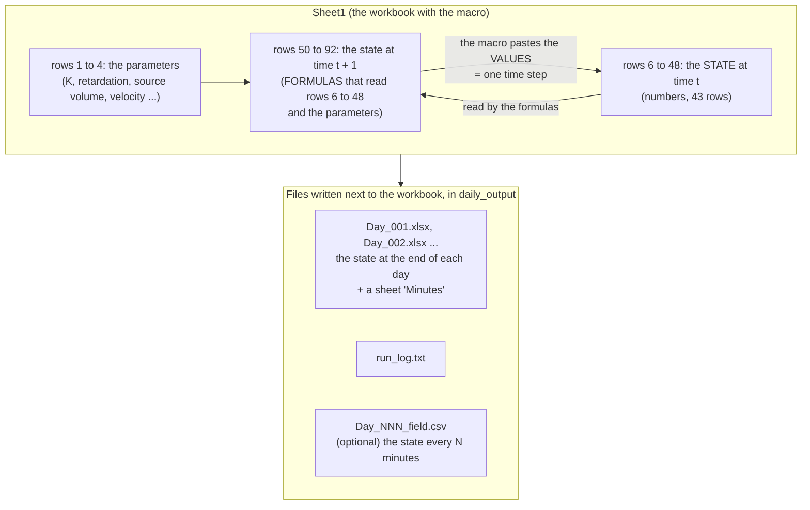
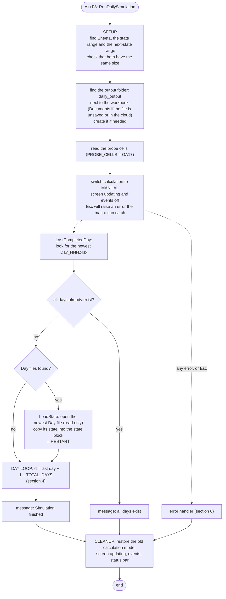
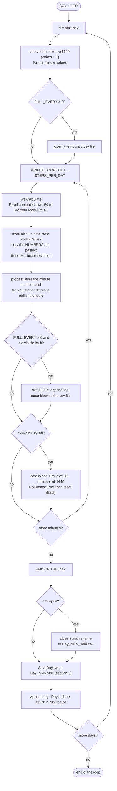
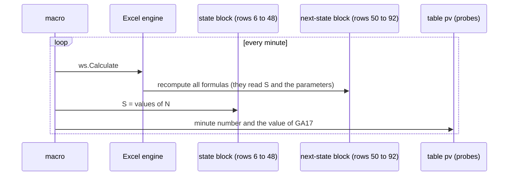
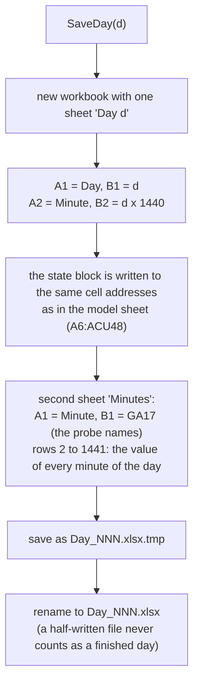
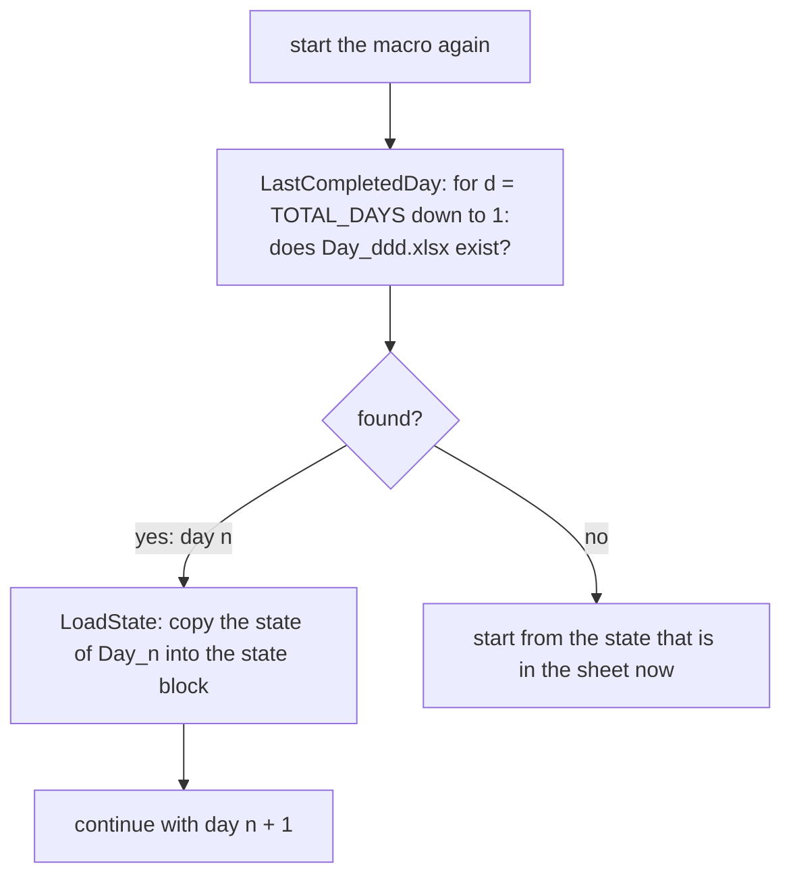
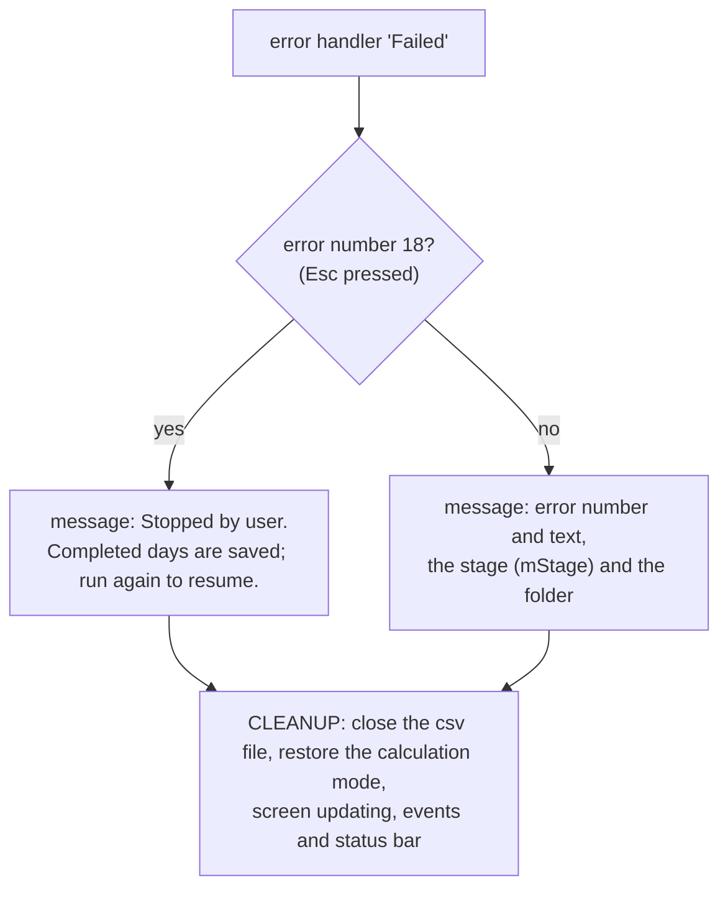
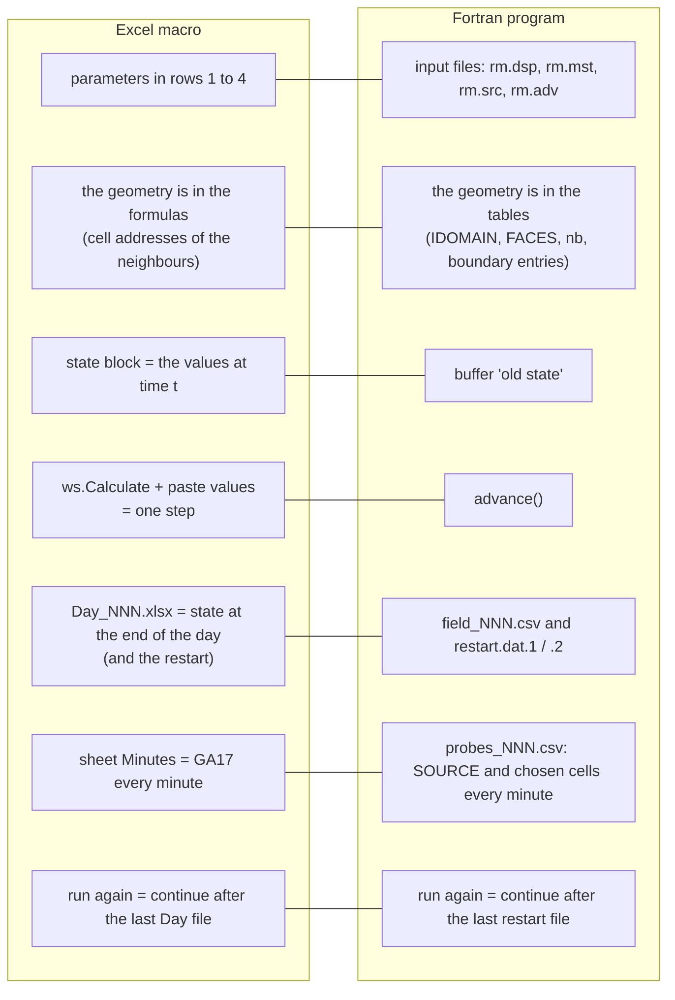

# How the Excel macro works

The macro `RunDailySimulation` (in `excel/DailyRun.bas`, and `excel/DailyRun_fixed.bas` for the corrected workbook) runs the spreadsheet model one day at a time. It was the first version of this model; the Fortran program ([How the Fortran program works](how-fortran.md)) computes the same numbers, and the two agree to 3e-16 (see the validation page of the manual). This page follows one run of the macro: what it reads, what it repeats and what it writes. It is written for teaching; every diagram can be shown on a screen.

How to read the diagrams: a rounded box is a start or a stop, a diamond is a question, a rectangle is a step.

## 1. The problem the macro solves

The full spreadsheet model needs one block of 43 rows for every minute, about 50,000 rows for 0.8 days, and a copy and paste by hand to carry on. The macro keeps **only two blocks** and repeats them: the formulas of the second block always read the first block, so after each recalculation the macro copies the *numbers* of the second block over the first block. That is one time step. After 1440 steps (one day) it saves the first block in its own file.



## 2. How the sheet is laid out

The model is a box of 29 layers x 43 rows x 25 columns. The sheet shows each **layer as a tile** of 25 columns, side by side, and each **row of the box as a row of the sheet**:

| Model | In the sheet |
|---|---|
| `IROW` 1 to 43 (row of the box) | sheet rows 6 to 48 in the state block, and 50 to 92 in the next-state block |
| `ICOL` 1 to 25 (column, away from the membrane) | the 25 columns of a tile; `ICOL = 1` is the first (left) column of the tile |
| `ILAY` 1 to 29 (layer) | tiles from left to right |
| the source | 225 cells with one and the same value: rows 15 to 29 in the extra column to the left of each tile of layers 8 to 22 (the membrane footprint) |

For the corrected workbook the tiles are at these columns (the original workbook has the last tile one column further left, `ABV:ACT`):

| ILAY | columns | note |
|---|---|---|
| 1 | `A:Y` | boundary layer |
| 2 | `AA:AY` | |
| 7 | `FA:FY` | |
| 8 | `GB:GZ` | the source column `GA` is on its left |
| 15 | `NI:OG` | the middle of the source, source column `NH` |
| 22 | `UP:VN` | the last layer of the footprint |
| 28 | `AAV:ABT` | |
| 29 | `ABW:ACU` | boundary layer |

The state block is the range `A6:ACU48` and the next-state block `A50:ACU92` (`A6:ACT48` and `A50:ACT92` in the original). They have the same size, which the macro checks.

### 2.1 One cell, as an example

The new value of the cell in layer 27, row 10, column 11 is in `AAE59`. It reads the old value `AAE15` and the old values of the six neighbours:

```text
AAE59 = AAE15                                  the cell itself (old value)
      + $GM$1/$GV$1 * (AAE16 - AAE15)           next row         (IROW + 1)
      + $GM$1/$GV$1 * (AAE14 - AAE15)           previous row     (IROW - 1)
      + $GM$1/$GV$1 * (AAF15 - AAE15)           next column      (ICOL + 1)
      + $GM$1/$GV$1 * (ZD15  - AAE15)           previous layer   (27 columns to the left)
      + $GM$1/$GV$1 * (ABF15 - AAE15)           next layer       (27 columns to the right)
      + $GM$1/$GV$1 * (AAD15 - AAE15)           previous column  (ICOL - 1)
      + $FZ$1 * AAE16 - $FZ$1 * AAE15           the flow term
```

`$GM$1` is the mass-transfer coefficient of the sand (Ks) and `$GV$1` the retardation R, so `$GM$1/$GV$1` is `ks` of the Fortran program. In the Fortran program the neighbours come from the table `nb`; in the sheet they are the cell addresses in the formula. The same formula is written in all 23,922 sand cells: the geometry is *in the formulas*.

The layer neighbours are exactly 27 columns away from each other. The original workbook broke this rule for the last tile (26 columns), and that was one of the two mistakes that were corrected.

### 2.2 The parameters (rows 1 to 4)

| Cell | Meaning |
|---|---|
| `GM1` | Ks, mass-transfer coefficient of the sand |
| `GV1` | R, retardation |
| `GG1` | Km, mass-transfer coefficient of the membrane |
| `FZ1` | velocity of the flow term |
| `GQ1` | source volume V (5625) |
| `GA17` | the source *mass* (V x concentration); the macro records it every minute |

## 3. The macro in one picture



The settings are constants at the top of the module (Alt+F11 to see them):

| Constant | Default | Meaning |
|---|---|---|
| `STEPS_PER_DAY` | 1440 | steps (minutes) per day |
| `TOTAL_DAYS` | 28 | days to simulate |
| `STATE_ADDR`, `NEXT_ADDR` | `A6:ACU48`, `A50:ACU92` | the two blocks |
| `PROBE_CELLS` | `GA17` | cells recorded every minute (comma separated) |
| `FULL_EVERY` | 0 | write the whole state to a csv file every N minutes (0 = off; 1 would make 100 MB a day) |
| `OUT_SUBFOLDER`, `OUT_BASE_OVERRIDE` | `daily_output`, empty | where the files go |

## 4. The loops: days and minutes



What happens in one minute, in more detail:



Why this is correct: the formulas of the second block read **only** the first block. Pasting the numbers of the second block into the first one therefore makes the next recalculation compute the following minute, with the formulas themselves untouched. Calculation is manual so that Excel recalculates only when the macro asks it to, once per minute, not after every pasted cell.

## 5. What is written



| File | Content | Used for |
|---|---|---|
| `Day_NNN.xlsx`, sheet `Day d` | the state at the end of day NNN, same cell addresses as the model sheet | the next day (restart) and the result of the day |
| `Day_NNN.xlsx`, sheet `Minutes` | minute number and the probe cells for every minute (default `GA17`, the source mass) | the time series of the source |
| `Day_NNN_field.csv` | the state block every `FULL_EVERY` minutes (optional) | finer time steps |
| `run_log.txt` | one line per finished day with the time it took | follow a long run |

The probe `GA17` is the source **mass** (volume x concentration). The Fortran probe file gives the **concentration**; dividing by `GQ1` (5625) gives the same number.

### 5.1 Restart



Two cautions that follow from this:

- The macro **overwrites the state block of the workbook** while it runs. Use a copy of the original file, and keep a clean copy of the initial state.
- To start a simulation again from day 1, delete the `daily_output` folder, otherwise the macro continues after the last Day file.

## 6. Stopping and errors



Pressing Esc loses the **current** day (it is not saved yet) and keeps all finished days. The variable `mStage` remembers what the macro was doing ("output folder", "running day 3", "saving day 3"), so an error message says where it stopped. The status bar line is refreshed every 60 minutes, and `DoEvents` gives Excel the chance to see the Esc key.

## 7. Macro and Fortran program side by side



| | Excel macro | Fortran program |
|---|---|---|
| Speed for 28 days | slow: Excel recalculates about 28,000 formulas every minute | about 2 seconds |
| Change the geometry | change the formulas of thousands of cells | change the input files (the `FACES` map, the rules) |
| The numbers | the same rule, in double precision | agree with the macro to 3e-16 |
| Source output | mass (V x C) | concentration |
| What to check after a change | compare with the Fortran run | compare with the macro run |

## 8. Teaching order (30 minutes)

1. **The two blocks** (5 min): section 1 and the picture of the sheet. Ask: "why is pasting values enough?"
2. **One formula** (5 min): section 2.1; let them find the six neighbours in the sheet, with `AAE59` open.
3. **The macro** (10 min): sections 3 and 4; open the module with Alt+F11 and follow `RunDailySimulation` line by line next to the diagram.
4. **Files and restart** (5 min): section 5.
5. **Esc and errors, and the comparison with Fortran** (5 min): sections 6 and 7.

A good exercise: run 10 steps with `STEPS_PER_DAY = 10` and `TOTAL_DAYS = 1` on a copy, open `Day_001.xlsx`, find the source in the `Minutes` sheet, and compare it with the first ten rows of `probes_001.csv` from the Fortran program (divide the macro value by 5625).
