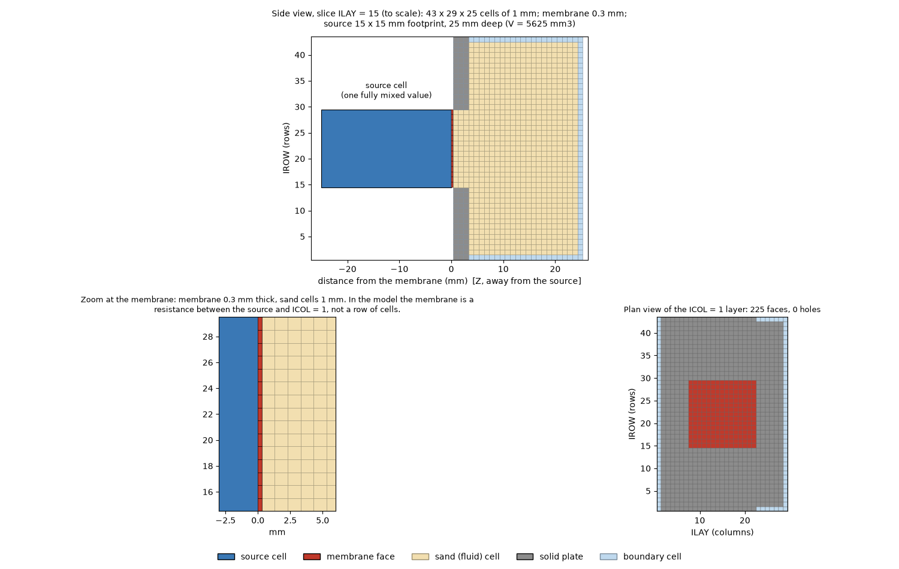

# memdif3d

**memdif3d** simulates diffusion from a fully mixed source cell through a membrane into a porous medium. It is an explicit finite-volume model on a regular grid of 1 mm cells with a time step of one minute, written in Fortran, with MODFLOW 6 style text input. It replaces a spreadsheet model that had to be run in pieces by hand: the 28-day case now runs in about 2 seconds on one core.

*Side view, zoom at the membrane and plan view of the Reduced_Matrix case, drawn by `tools/plot_domain.py` from the input files.*

## What it does
- A **source cell** (one concentration for the whole volume) loses solute through the **membrane**, a 0.3 mm resistance between the source and the first sand cells.
- Solute spreads through the **sand** by diffusion (optionally with sorption and a one-way flow term).
- The membrane can have **holes** (faces without membrane) or **closed** faces.
- The outer cells of the box are **boundary cells**: each side has a rule (`COPY factor`, `FIXED value` or `NOFLOW`).
- Output: the whole field once per day (or more often), concentration time series at chosen cells, and restart files.

## Where to start
| You want to | Read |
|---|---|
| run the example | [Quick start](quickstart.md) |
| install or compile it | [Install and build](install.md) |
| understand the equations | [Theory](theory.md) |
| know what each input file holds | [Input files](INPUT_SPEC.md) |
| read the results | [Output files](outputs.md) |
| set up your own case | [Build your own model](build-your-model.md) |
| see how well it matches the spreadsheet | [Validation](VALIDATION.md) |

## The grid and its names
The grid uses MODFLOW names: **layers** (`ILAY`), **rows** (`IROW`) and **columns** (`ICOL`), numbered from 1. In the Reduced_Matrix case it is 29 layers by 43 rows by 25 columns. `ICOL` runs away from the source and `ICOL = 1` touches the membrane. The correspondence with the axes of the original recording is in the [model specification](MODEL_SPEC.md).

## Status
The solver reproduces the spreadsheet to rounding error (2e-16 after 576 steps against the full workbook, and against the output of the daily macro). Sorption, advection and the hole feature are tested against a Python prototype and a sealed-box mass balance, but not against a spreadsheet run yet. See [Validation](VALIDATION.md) for the numbers.

Licensed under the MIT License.
